# AWS 웹사이트 인터넷 배포

## 1. 프로젝트 개요

AWS에서 전용 네트워크를 설계하고, Public Subnet의 EC2 인스턴스에 Nginx 웹 서버를 배포한 실습 기록이다. 

AWS 서울 리전에서 전용 VPC와 Public Subnet을 구성하고, 외부 브라우저의 HTTP 접속을 검증했다. 

IAM 최소 권한과 Security Group 규칙을 분리해 적용했으며, 실습 종료 후에는 생성한 리소스를 삭제하는 과정까지 기록했다.

프로젝트 목적은 다음과 같다.

1. VPC, Public Subnet, Internet Gateway, Route Table을 연결하여 인터넷 통신 경로를 이해한다.
2. EC2에 웹 서버를 배포하고 외부 HTTP 접속을 통해 서비스 동작을 검증한다.
3. IAM 최소 권한과 Security Group의 역할을 구분하여 필요한 접근만 허용한다.
4. 실습 종료 후 리소스를 삭제하고, 비용 및 보안 측면의 정리 절차를 문서화한다.

## 2. 디렉토리 구조

```text
/
├── README.md
└── docs/
    ├── architecture.png                 # README에 사용한 아키텍처 다이어그램
    ├── architecture-v2.svg              # ai로 생성한 아키텍처 다이어그램 
    ├── cleanup-checklist.md             # 리소스 삭제 및 비용 확인 체크리스트
    ├── troubleshooting.md               # 장애 원인·조치·재발 방지 보고서
    └── screenshots/
        ├── 00~23-*.png                  # IAM·네트워크·EC2 구성 및 검증 캡처
        ├── cleanup-resources/
        │   └── 01~22-*.png              # 리소스 삭제·정리 증거
        └── troubleshooting/
            └── 01~06-*.png              # 트러블슈팅 증거
```

## 3. 아키텍처

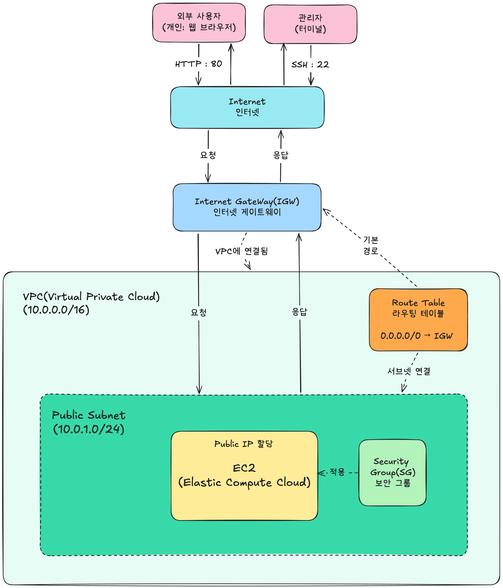

- Internet Gateway는 VPC에 연결했다.
- Route Table은 Public Subnet에 연결했고, 기본 경로 `0.0.0.0/0 → IGW`로 인터넷 트래픽의 경로를 지정했다.
- Security Group은 EC2에 적용해 HTTP(80)와 SSH(22) 접근을 제어했다.

<details>
<summary>네트워크 구성 캡처</summary>

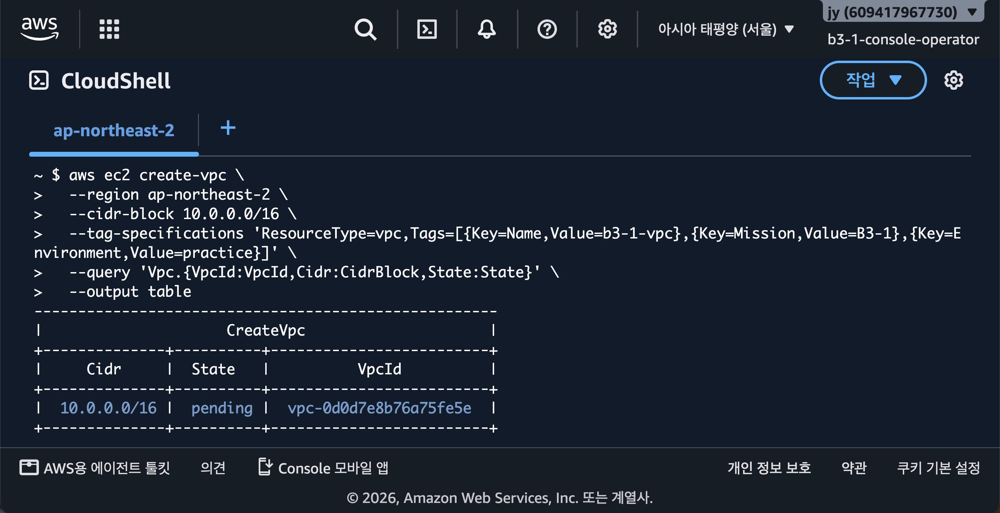

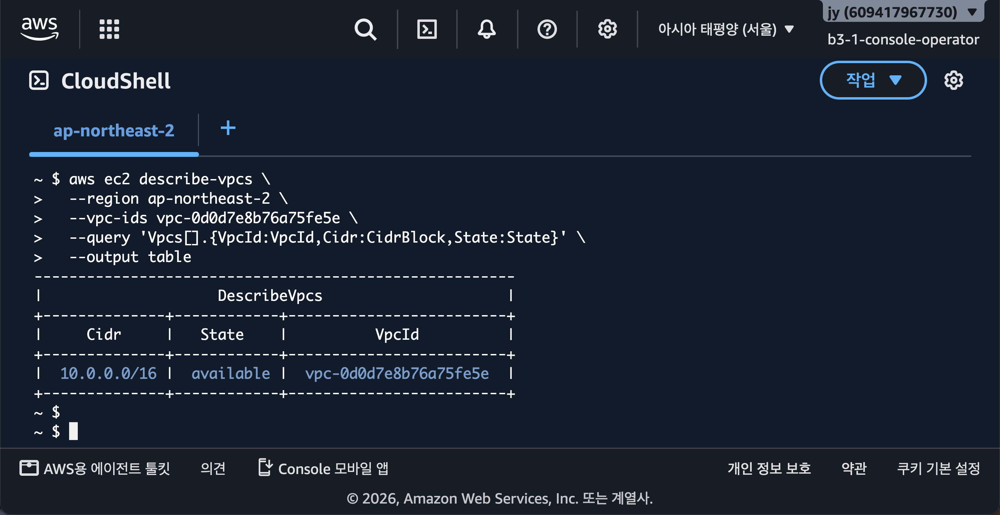

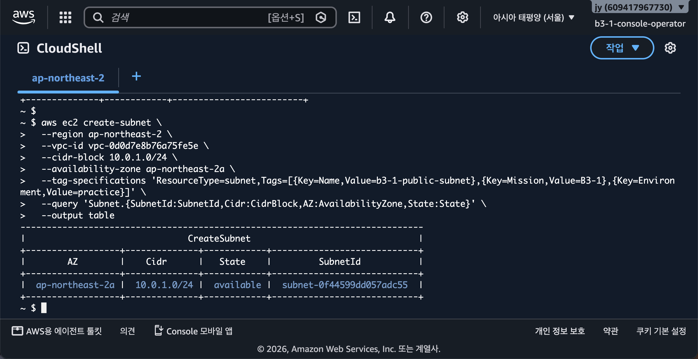

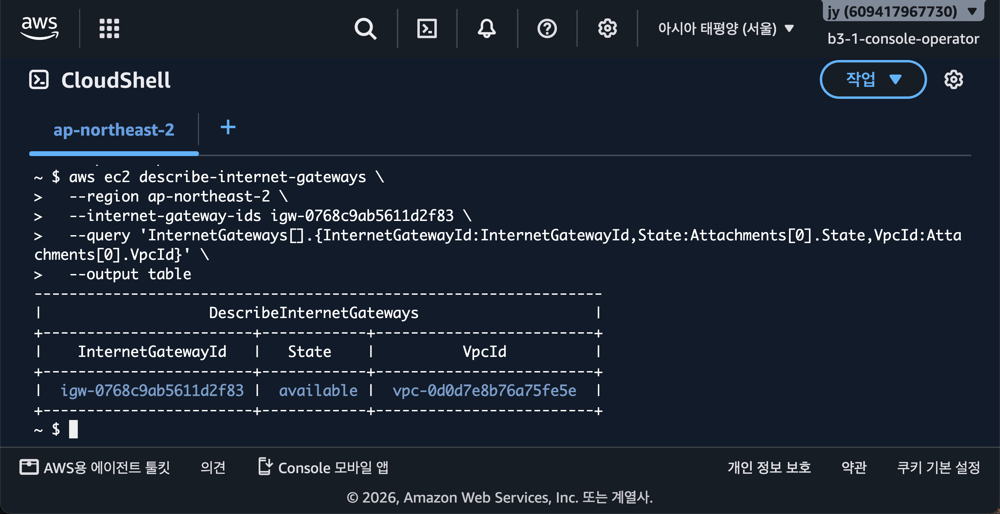

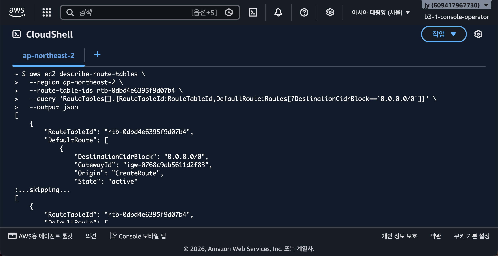

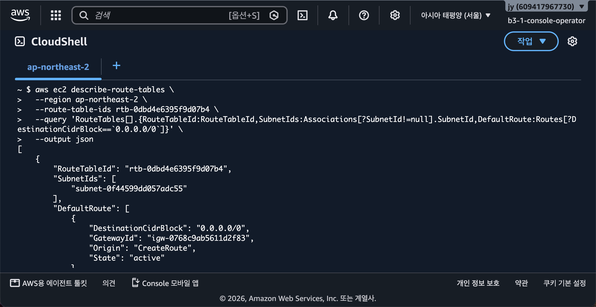

</details>

## 4. 리소스 구성

| 구성요소 | 값 |
|---|---|
| VPC | `vpc-0d0d7e8b76a75fe5e` / `10.0.0.0/16` |
| Public Subnet | `subnet-0f44599dd057adc55` / `10.0.1.0/24` |
| Availability Zone | `ap-northeast-2a` |
| Internet Gateway | `igw-0768c9ab5611d2f83` |
| Route Table | `rtb-0dbd4e6395f9d07b4` |
| Route Table 연결 | `rtbassoc-0efc4e9ce2b2a91a7` |
| Security Group | `sg-0b94cd6b36b9a5930` (`b3-1-web-sg`) |
| EC2 | `i-008c24655f5342f43` |
| Instance type | `t3.micro` |
| AMI | Ubuntu 26.04 LTS, x86 |
| Key pair | `b3-1-ec2-key` |
| Public IP | `15.165.237.245` |
| Private IP | `10.0.1.30` |

## 5. IAM 최소 권한

`b3-1-console-operator` IAM 사용자에 사용자 지정 정책 `B3-1-Minimum-Operations`를 직접 연결했다. 이 정책은 CloudShell 사용과 B3-1 구성에 필요한 EC2·VPC·보안 그룹 작업만 허용했고, `AdministratorAccess`나 S3·RDS 같은 범위 밖 서비스 권한은 부여하지 않았다.

IAM은 **AWS 리소스를 변경할 수 있는 사용자 권한**을 제어한다. 반면 Security Group은 생성된 EC2에 들어오고 나가는 **네트워크 트래픽**을 제어한다.

<details>
<summary>IAM 정책 연결·권한 확인 캡처</summary>

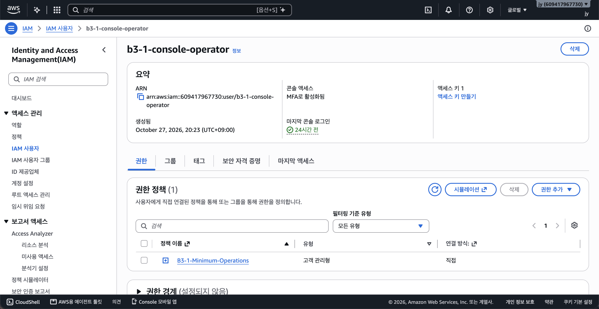

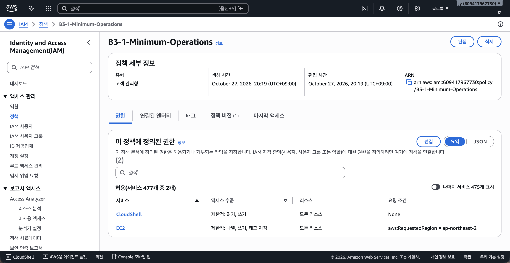

</details>

## 6. 네트워크 및 보안 설정

### 6.1 Route Table

- VPC 내부 경로: `10.0.0.0/16 → local`
- 인터넷 기본 경로: `0.0.0.0/0 → igw-0768c9ab5611d2f83`
- Public Subnet에 Route Table을 `associated` 상태로 연결했다.

`0.0.0.0/0`은 VPC 내부 경로에 해당하지 않는 모든 IPv4 목적지를 뜻한다. 이 기본 경로의 대상으로 IGW를 지정해 Public Subnet의 인스턴스가 외부 인터넷과 통신하도록 구성했다.

### 6.2 Security Group

| 방향 | 프로토콜/포트 | 소스 또는 대상 | 목적 |
|---|---|---|---|
| Inbound | TCP 80 | `0.0.0.0/0` | 웹 서비스 외부 공개 |
| Inbound | TCP 22 | 신뢰하는 접속지 공인 IPv4 `/32` | 개인 컴퓨터에서만 SSH 허용 |
| Outbound | 전체 | `0.0.0.0/0` | 실습에 필요한 외부 통신 |

HTTP 80은 누구나 웹 페이지에 접속할 수 있도록 공개했다. SSH 22는 전체 인터넷에 공개하지 않고 신뢰하는 접속지 공인 IP `/32`로 제한했다. 접속 장소나 네트워크가 바뀌면 필요한 현재 IP만 추가하고, 더 이상 쓰지 않는 규칙은 제거해야 한다.

<details>
<summary>Security Group 규칙 확인 캡처</summary>

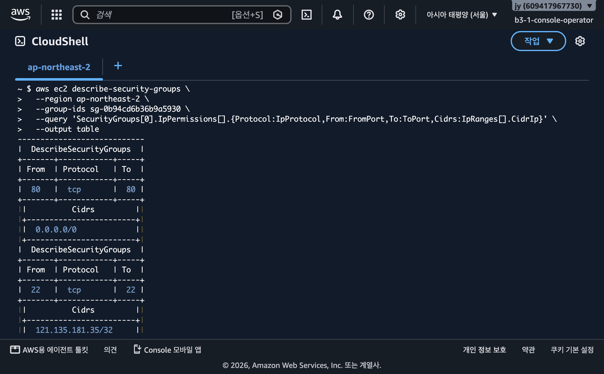

</details>

## 7. EC2 접속 및 웹 서버 구성

개인 컴퓨터에서 다음 명령으로 접속했다.

```bash
ssh -i ~/Downloads/b3-1-ec2-key.pem ubuntu@15.165.237.245
```

EC2 내부에서 Nginx를 수동 설치했다.

```bash
sudo apt update
sudo apt install -y nginx
sudo systemctl enable --now nginx
```

웹 페이지는 `/var/www/html/index.html`에서 직접 작성했고, 현재 `B3-1 웹 서버` 문구를 제공한다.

<details>
<summary>키 페어·EC2·SSH 접속 캡처</summary>

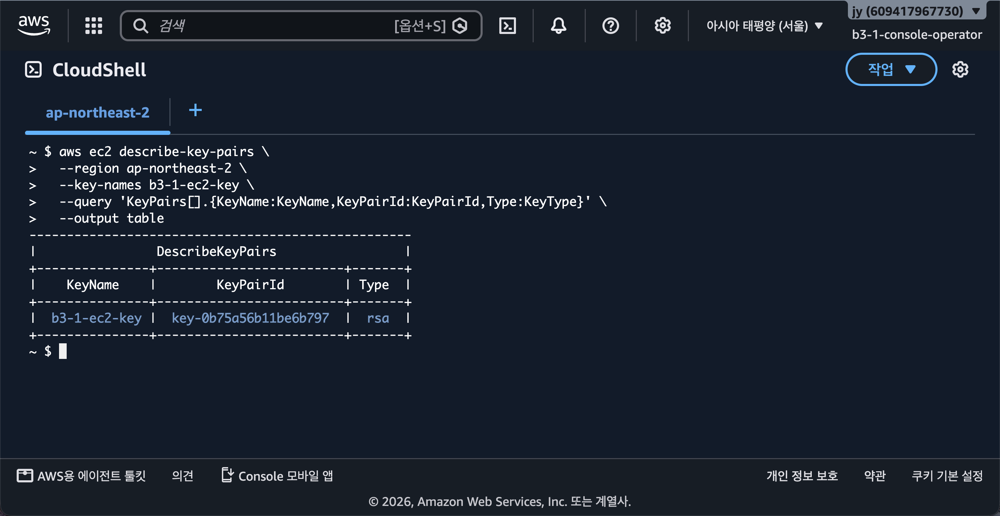

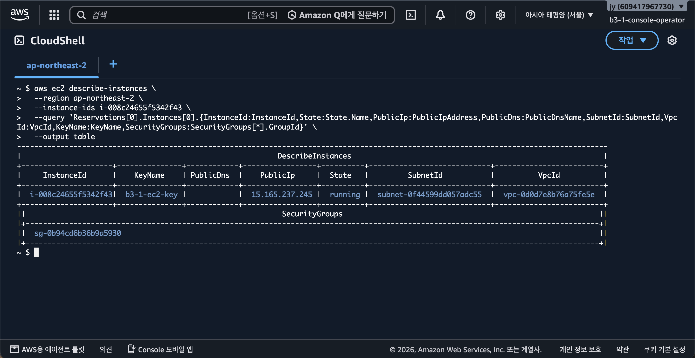

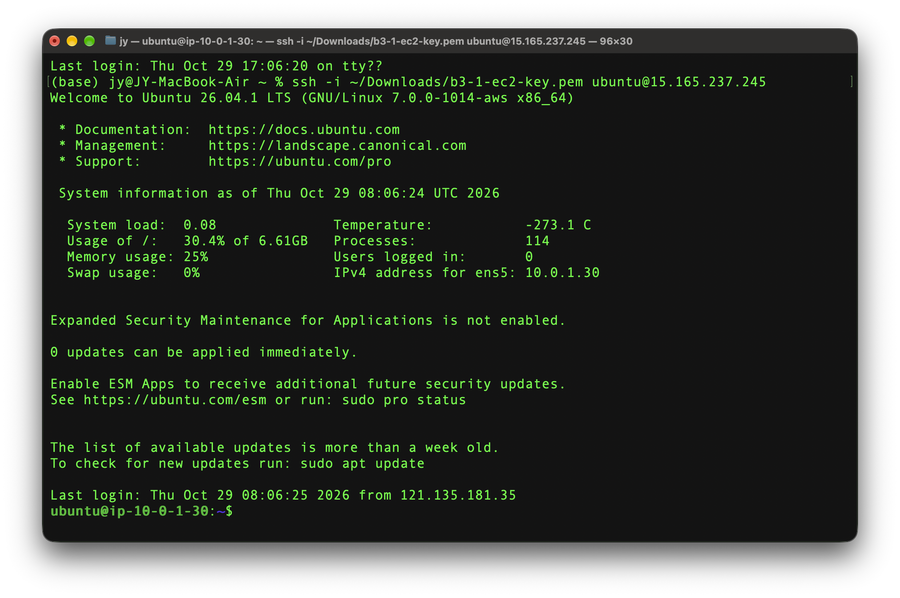

</details>

## 8. 검증 결과

### 8.1 EC2 내부 및 아웃바운드 통신 검증

Public Subnet에 배치된 인스턴스가 인터넷으로 나갈 수 있는지, 그리고 EC2 내부의 Nginx가 HTTP 요청을 처리하는지 확인했다.

```bash
echo "=== Outbound Internet Check ==="
curl -I -L --max-time 10 https://example.com

echo "=== Local Nginx Check ==="
curl -i http://localhost/
```

- `https://example.com`이 `HTTP/2 200`을 반환했다. EC2가 Route Table의 `0.0.0.0/0 → IGW` 경로를 통해 인터넷으로 나가 응답을 받은 근거다.
- `http://localhost/`가 `HTTP/1.1 200 OK` 및 `Server: nginx/1.28.3 (Ubuntu)`를 반환했다. EC2 내부에서 Nginx가 TCP 80 포트로 실행 중인 근거다.

<details>
<summary>EC2 내부·아웃바운드 통신 검증 캡처</summary>

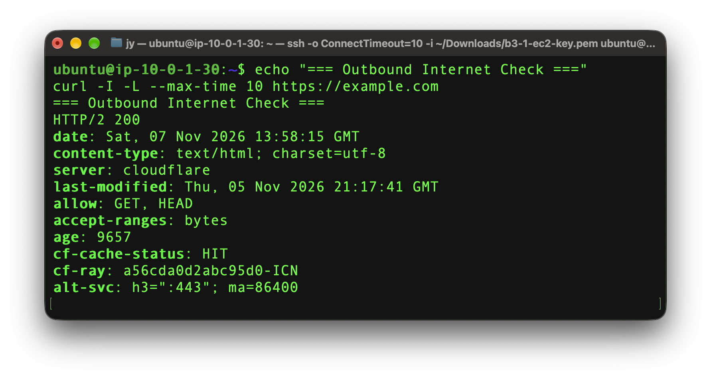

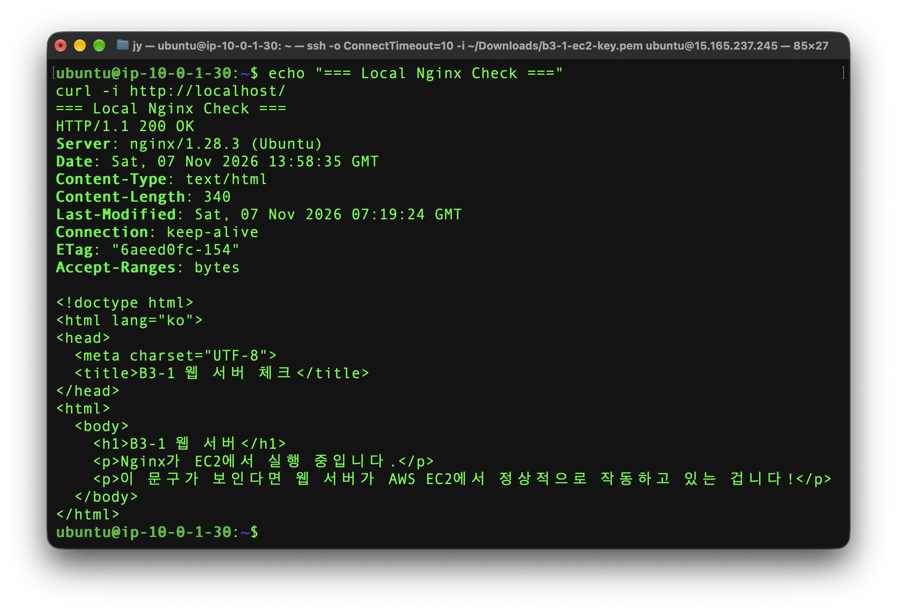

</details>

### 8.2 외부 검증 A — 브라우저

개인 컴퓨터의 웹 브라우저에서 다음 주소를 열어 페이지를 확인했다.

```text
http://15.165.237.245/
```

페이지에 `B3-1 웹 서버`와 Nginx 실행 상태를 나타내는 문구가 표시됐다. 이는 공인 IP로 들어온 HTTP 요청이 IGW·Public Subnet을 거쳐 EC2의 Nginx까지 도달했음을 보여준다.

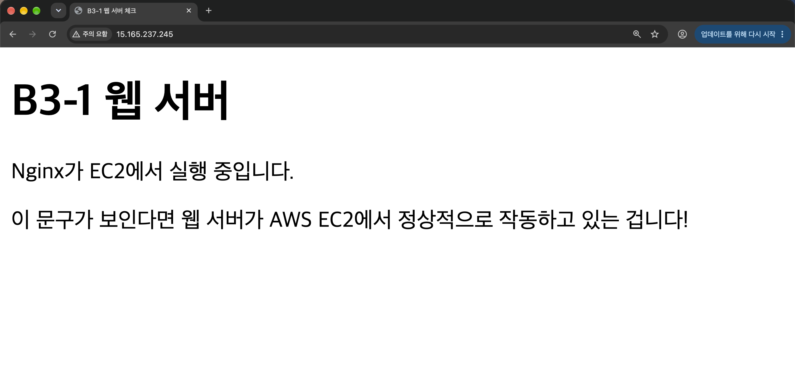


