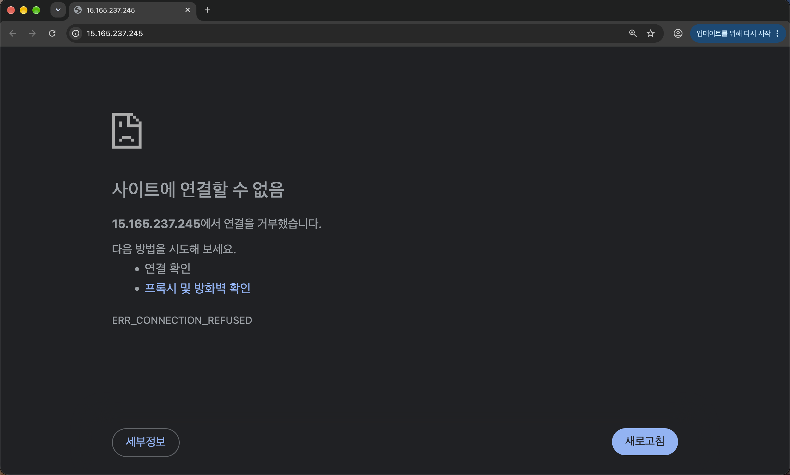
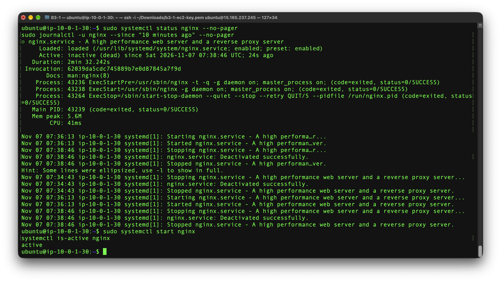
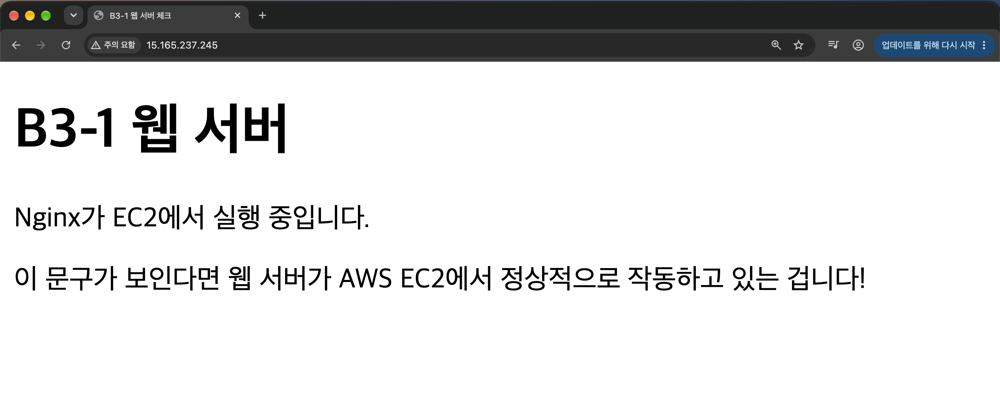
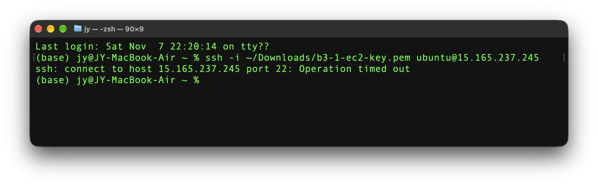
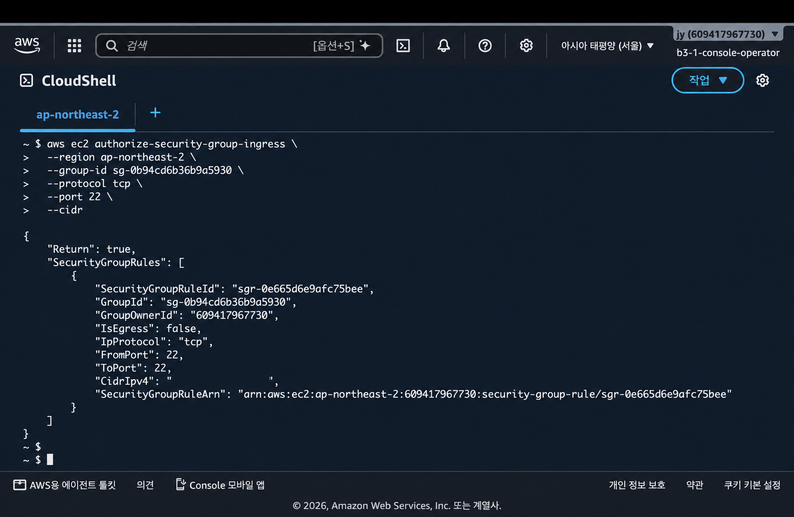
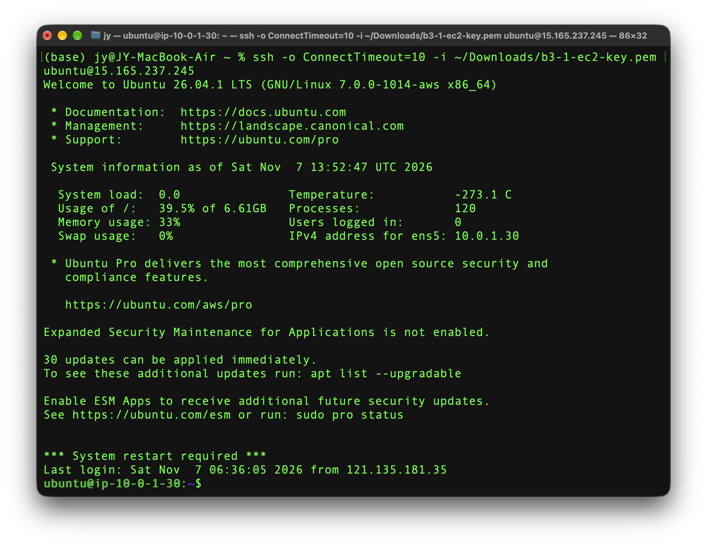

# B3-1 트러블슈팅 보고서

## 사례 1 — Nginx 외부 HTTP 접속 장애

- 대상: EC2 Ubuntu 인스턴스의 Nginx 웹 서버
- 검증 방식: A 방식 — 개인 컴퓨터의 웹 브라우저에서 공인 IP로 접속
- 검증 주소: `http://15.165.237.245`
- 수행일: 2026-11-07

### 1. 상황과 재현 방법

Nginx 서비스가 중지되었을 때 외부 웹 접속에 어떤 영향이 생기는지 확인하기 위해, SSH로 EC2에 접속한 뒤 안전하게 중지 상황을 재현했다.

```bash
sudo systemctl stop nginx
```

이는 실제 운영 장애가 아니라, 점검 절차를 검증하기 위한 의도적인 장애 재현이다.

### 2. 증상

개인 컴퓨터의 브라우저에서 공인 IP로 접속했을 때 다음 오류가 표시됐다.

- 메시지: `사이트에 연결할 수 없음`
- 오류 코드: `ERR_CONNECTION_REFUSED`



`CONNECTION_REFUSED`는 EC2 공인 IP까지의 네트워크 경로를 무조건 배제할 수는 없지만, 서버가 HTTP 80 포트에서 요청을 수신하는지 우선 점검해야 하는 증상이다.

### 3. 진단

SSH로 EC2에 접속해 Nginx 서비스 상태와 최근 로그를 확인했다.

```bash
sudo systemctl status nginx --no-pager
sudo journalctl -u nginx --since "10 minutes ago" --no-pager
```

확인 결과:

- 서비스 상태가 `Active: inactive (dead)`였다.
- 로그에 `Stopping nginx.service`, `nginx.service: Deactivated successfully`, `Stopped nginx.service`가 기록되어 있었다.
- 따라서 보안 그룹이나 라우팅보다 **Nginx 프로세스 중지**를 우선 원인으로 판단했다.

### 4. 조치

Nginx를 다시 시작하고 실행 상태를 확인했다.

```bash
sudo systemctl start nginx
systemctl is-active nginx
```

`active`가 반환되어 웹 서버 프로세스가 다시 HTTP 80 포트 요청을 수신할 수 있는 상태임을 확인했다.



### 5. 복구 검증

개인 컴퓨터 브라우저에서 같은 공인 IP 주소를 다시 열어 Nginx가 제공하는 페이지가 정상 표시되는 것을 확인했다.



### 6. 결과

외부 HTTP 접속 실패는 Nginx 서비스가 중지되어 발생한 것으로 확인했고, `systemctl start nginx`로 서비스를 복구한 뒤 브라우저 외부 접속이 정상화됐다. 점검 순서는 **외부 증상 확인 → 서버 프로세스 상태·로그 확인 → 조치 → 외부 재검증**으로 수행했다.

### 7. 재발 방지

- Nginx 설치 후 `sudo systemctl enable nginx`으로 부팅 시 자동 시작되도록 유지한다.
- 배포·설정 변경 뒤에는 `systemctl is-active nginx`, `curl -i http://localhost/`, 외부 브라우저 접속 순서로 서비스 상태를 확인한다.
- 외부 접속 실패가 발생하면 라우팅·보안 그룹을 바로 변경하기 전에 Nginx 프로세스 상태와 로그를 먼저 확인한다.

---

## 사례 2 — 접속 장소 변경 후 SSH 시간 초과

- 대상: EC2 Ubuntu 인스턴스의 SSH 인바운드 규칙(TCP 22)
- 수행일: 2026-11-07
- 보안 기준: SSH는 전체 공개하지 않고, 신뢰하는 접속지의 공인 IPv4를 `/32`로만 허용

### 1. 상황

기존 접속 장소에서 벗어난 뒤 같은 SSH 명령으로 EC2에 접속했다. 보안 그룹의 TCP 22 인바운드는 이전 접속지의 공인 IP만 허용하도록 제한되어 있었다.

### 2. 증상

개인 컴퓨터에서 SSH를 시도했지만 다음 시간 초과 오류가 발생했다.

```text
ssh: connect to host 15.165.237.245 port 22: Operation timed out
```



### 3. 진단

접속 장소가 바뀌면 인터넷에 표시되는 공인 IP도 달라질 수 있다. 보안 그룹의 TCP 22 규칙을 조회해 기존 허용 IP와 현재 접속지 IP를 확인했고, 현재 접속지의 IP가 허용 목록에 없다는 점을 원인으로 판단했다.

### 4. 조치

현재 접속지의 공인 IPv4만 `/32` CIDR로 TCP 22 인바운드에 추가했다. `0.0.0.0/0`으로 SSH를 공개하지 않았으며, 기존 허용 IP도 유지했다.



현재 접속지 IP는 제출용 이미지에서 마스킹했다.

### 5. 복구 검증

추가한 뒤 개인 컴퓨터에서 동일한 키 페어로 다시 SSH 접속해 Ubuntu 로그인 배너와 `ubuntu@ip-10-0-1-30` 프롬프트를 확인했다.



### 6. 결과

문제는 인스턴스나 키 페어가 아니라 **변경된 접속지의 공인 IP가 SSH 허용 목록에 없었던 것**으로 확인됐다. SSH 접근은 신뢰하는 출발지 IP를 `/32`로 제한하고, 장소·네트워크가 바뀌면 필요한 IP만 추가하거나 불필요해진 규칙을 제거하는 방식으로 관리한다.

### 7. 재발 방지

- SSH 접속 전에 현재 접속지의 공인 IPv4가 보안 그룹 TCP 22 허용 목록에 있는지 확인한다.
- 장소나 네트워크가 바뀐 경우 현재 공인 IP만 `/32`로 추가하고, 더 이상 사용하지 않는 IP 규칙은 제거한다.
- 편의를 위해 TCP 22를 `0.0.0.0/0`으로 공개하지 않고, 시간 초과가 발생하면 키 페어보다 먼저 보안 그룹의 소스 IP 규칙을 점검한다.
